# Instructional Agents Studio: User Guide

[Studio README](../README.md) · [Project homepage](https://darl-genai.github.io/instructional_agents_homepage/) · [Instructional Agents](https://github.com/DaRL-GenAI/instructional_agents)

This guide is for instructors using the Studio for the first time. It starts from installation and goes one step at a time. You do not need programming experience. Each step has a screenshot, and the words on the buttons in the screenshots are the words to look for on your screen.

**Contents**

1. [Install (once)](#1-install-once)
2. [Start the app](#2-start-the-app)
3. [Enter the key for the AI service](#3-enter-the-key-for-the-ai-service)
4. [Turn your existing slides into a course](#4-turn-your-existing-slides-into-a-course)
5. [Rebuild the course outline from your slides](#5-rebuild-the-course-outline-from-your-slides)
6. [Let Claude Code or Codex edit your files](#6-let-claude-code-or-codex-edit-your-files)
7. [Edit slides and Word files yourself](#7-edit-slides-and-word-files-yourself)
8. [See the history and undo changes](#8-see-the-history-and-undo-changes)
9. [Make the text larger](#9-make-the-text-larger)
10. [If something goes wrong](#10-if-something-goes-wrong)

## 1. Install (once)

The Studio runs on your own computer. A course is a folder on your computer and is not uploaded anywhere. It works on Windows, Mac and Linux.

### Step 1: Install Node.js

Go to [nodejs.org](https://nodejs.org), download the installer marked **LTS** (version 20.19 or newer), open it, and click **Next** until it finishes.

### Step 2 (optional): Install Claude Code or Codex

Install one of these (or both) if you want an AI assistant to edit your slides and documents directly. If you only want to generate course materials, you can skip this step.

- **Claude Code**: follow the [official setup guide](https://docs.anthropic.com/en/docs/claude-code/setup), then type `claude` in a terminal and sign in once.
- **Codex**: type `npm install -g @openai/codex` in a terminal, then type `codex login` and sign in once.

> **Where is the terminal?**
> Windows: press the Windows key, type "cmd" and open **Command Prompt**.
> Mac: press <kbd>⌘</kbd> + Space, type "Terminal" and press Return.

## 2. Start the app

There is nothing to double-click: the Studio is started from the terminal, and it opens in your web browser (Chrome, Edge, Safari or Firefox). Do the same every time you want to use it.

### Step 1: Open a terminal

Windows: press the Windows key, type "cmd" and open **Command Prompt**. Mac: press <kbd>⌘</kbd> + Space, type "Terminal" and press Return.

### Step 2: Type this line and press Enter

```
npx instructional-agents
```

The first time, it asks `Ok to proceed? (y)`. Type `y` and press Enter, then wait a minute or two while it downloads. Later starts take a few seconds.

When it is ready, the terminal shows something like this:

```
Instructional Agents 0.1.1 on http://127.0.0.1:8790 (editor: ...)

  Open http://127.0.0.1:8790/?token=Xy3...#/projects
  (keep this window open while you use the app; Ctrl+C stops it)
```

### Step 3: The Studio opens in your browser

Your browser opens a new tab with the Studio by itself (the page in the screenshot at the end of this section).

If no tab opens, open it yourself: copy the whole address after **Open** (it starts with `http://127.0.0.1:8790/?token=`) and paste it into your browser's address bar. On a Mac, you can also hold <kbd>⌘</kbd> and click the address in the terminal.

The address contains a one-time password (the part after `token=`). Use the address from this start; an address from an earlier start, or a bookmark, shows "this tab needs its access link".

> **Please do not close the terminal window.** If it is closed, the Studio stops. When you are done, press <kbd>Ctrl</kbd> + <kbd>C</kbd> in that window to quit, then close the browser tab.
> **Next time**, open a terminal and type `npx instructional-agents` again. If the Studio is still running, the line just opens the page again.

### Step 4 (optional): Check the installation

Type `npx instructional-agents doctor` to see which parts are installed. A line that starts with `ok` is fine:

```
  ok      Node.js      v22.12.0
  ok      Claude Code  2.1.326 (Claude Code)
  ok      Codex        codex-cli 0.154.0
  ok      LaTeX        latexmk (/usr/bin/latexmk)
  ok      Editor       0.1.1, npm
  ok      git          built in (isomorphic-git)
```

`Editor` is the built-in slides and Word editor. It is installed together with the app and works without a network.

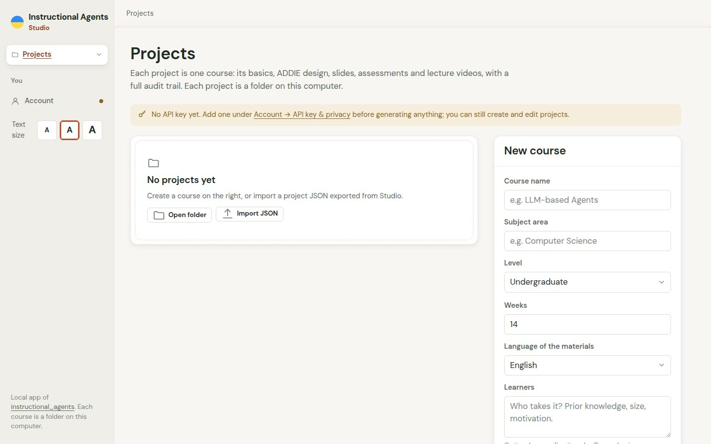
*The page on first start. **Text size** at the lower left makes the text larger at any time (see section 9).*

## 3. Enter the key for the AI service

To generate outlines, slides and assignments, the Studio uses an AI service (for example OpenAI, or a service provided by your school). You need its address and its key (a string of characters that works like a password). If you are not sure what these are, ask your school's IT department or a teaching assistant.

If you only use Claude Code or Codex to edit files, you do not need this key. They use their own sign-in.

### Step 1: Click **Account** on the left, then **API key & privacy**

Paste the key into the box, click **Save key**, then click **Test connection** to try it.

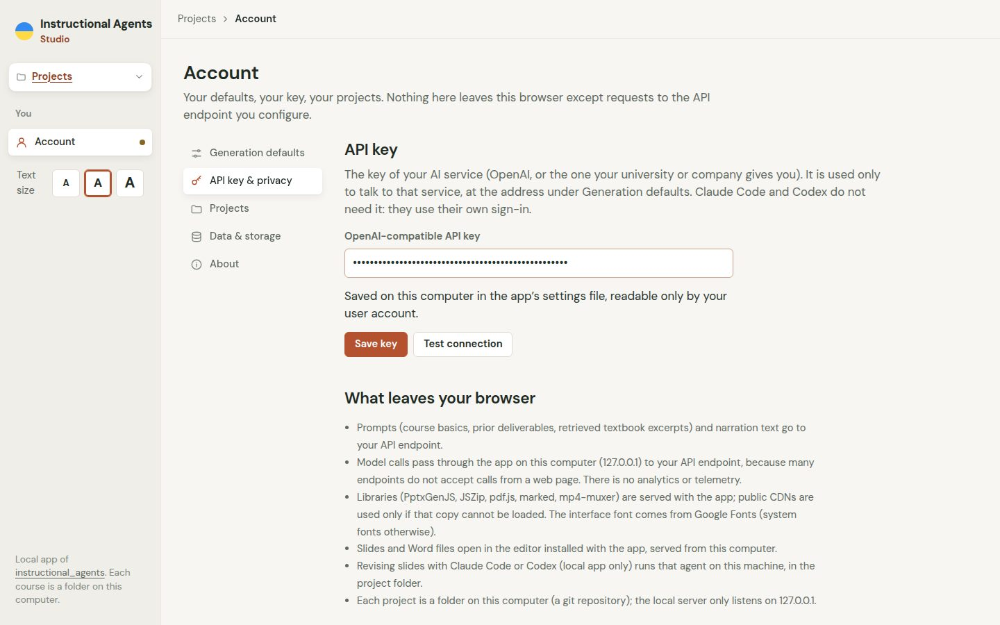
*The key is stored only on this computer, readable only by your user account.*

### Step 2: Click **Generation defaults** and fill in the address and the model

Enter the service address under **API base URL** and the model name under **Text model**, then click **Save defaults** at the bottom of the page.

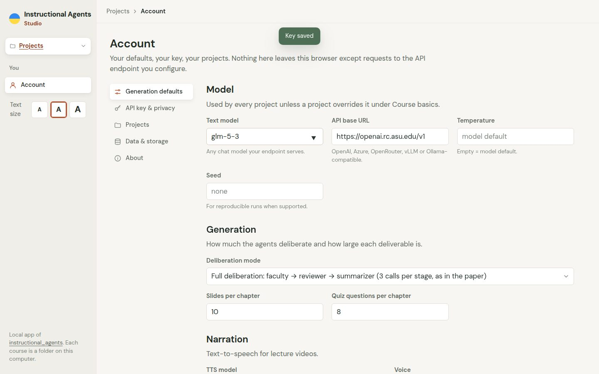
*Example: ASU's service address is https://openai.rc.asu.edu/v1 and the model is glm-5-3.*

## 4. Turn your existing slides into a course

Say you have a folder of slides (.pptx) from past teaching. The file names may be messy and the order may be wrong. That is fine.

### Step 1: Go back to the home page and click **Open folder**

In the window that opens, click through to your folder (or paste the folder's path into the box at the top and press Enter), then click **Open** at the lower right.

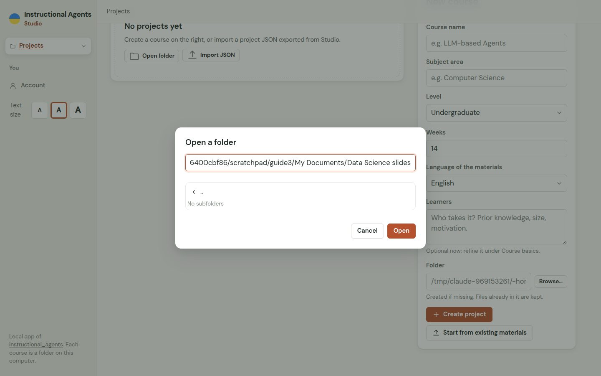

### Step 2: Check the course name and click **Open as course**

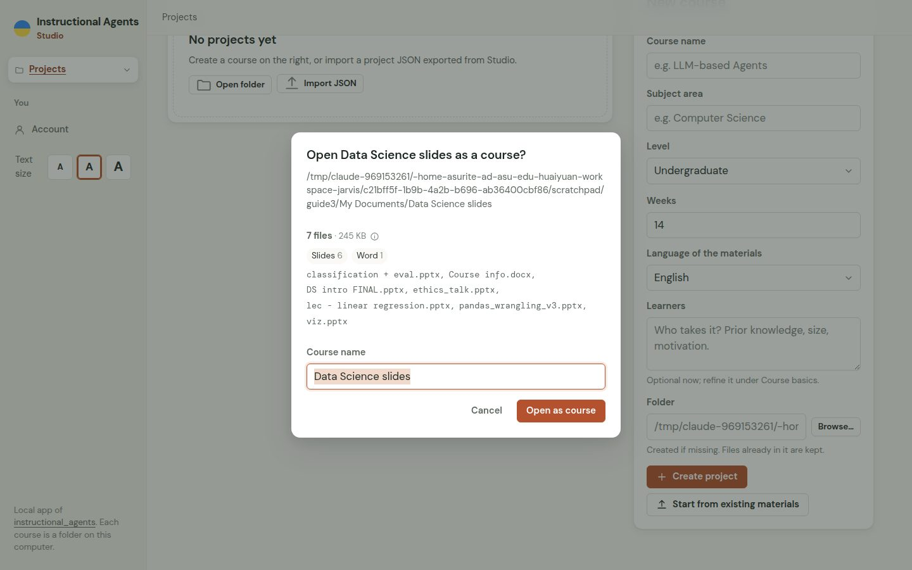
*The Studio lists what is in the folder. Your original files are not moved and not changed.*

### Step 3: Check the table and click **Apply**

The Studio works out what each file is (Slides, Syllabus and so on) and makes one chapter for each set of slides. If a row is wrong, change it in its drop-down list. To leave a file out, untick it on the left.

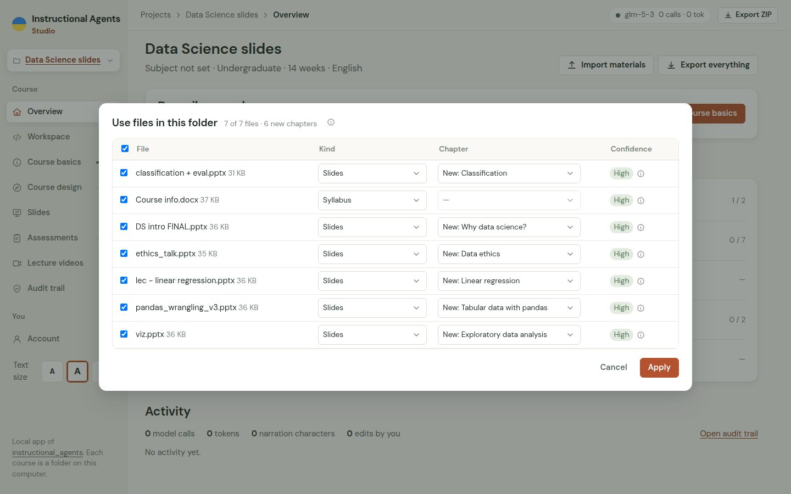

## 5. Rebuild the course outline from your slides

When all you have is a set of slides, the Studio can read them and work out the chapter order, a syllabus and learning objectives. You can then edit these, or go on to generate assignments, quizzes and more.

### Step 1: Click **Course design** on the left, then **Rebuild course design from slides** in the blue notice

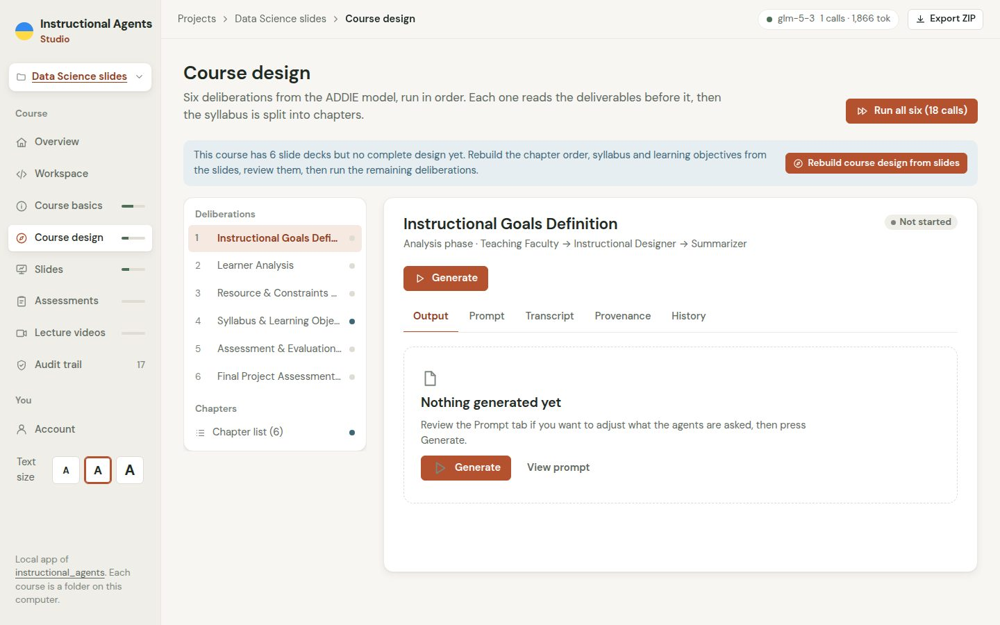

### Step 2: Look over the changes and click **Keep**

After about a minute, the right side lists what will be written: green is new, red is replaced. If you are happy with it, click **Keep**. If not, click **Discard**.

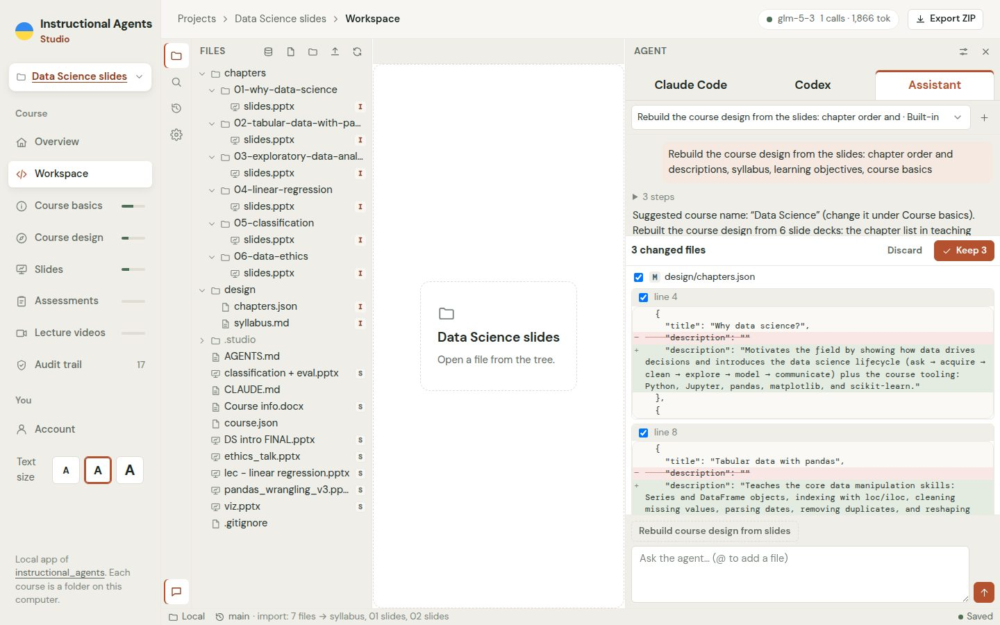

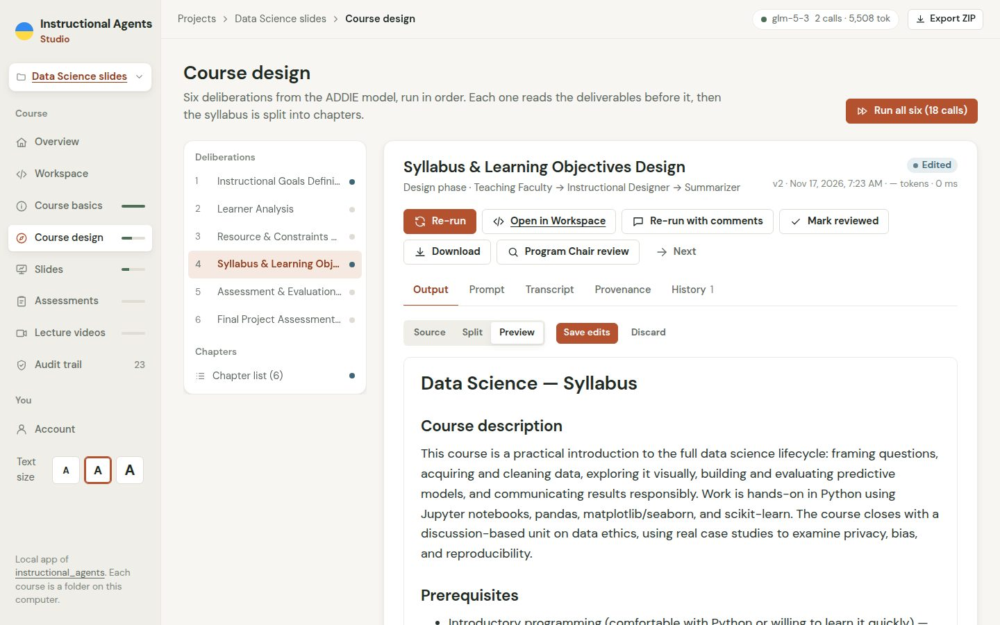
*The rebuilt syllabus. Anything the slides do not say, and that was inferred, is marked (inferred). Please check those parts.*

### Step 3: Fill in missing topics

Under **Course design** → **Chapter list**, the Studio lists topics that a course like yours usually covers but your slides do not. Click **Add as chapter** to add one as a new chapter. You can then generate slides for it from scratch under **Slides**.

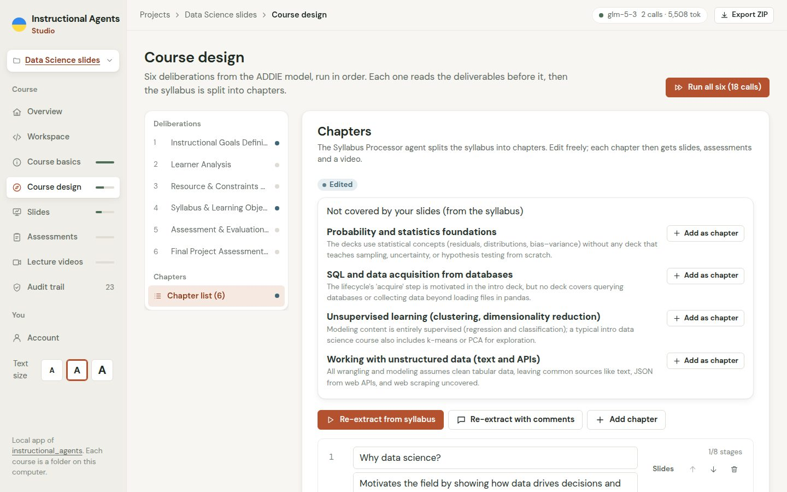

To fill in the rest of the course design (learner analysis, assessment plan and so on), click **Run all six** at the upper right of the page. The syllabus and learning objectives you already have are kept, not overwritten.

## 6. Let Claude Code or Codex edit your files

Click **Workspace** on the left. Files and the editor are in the middle; the assistant panel is on the right, with three large tabs at the top: **Claude Code**, **Codex** and **Assistant** (the built-in assistant). Claude Code and Codex work here exactly as they do in a terminal, with a few large buttons added to make them easier to use.

### Step 1: Click the **Claude Code** tab, then **Start Claude Code**

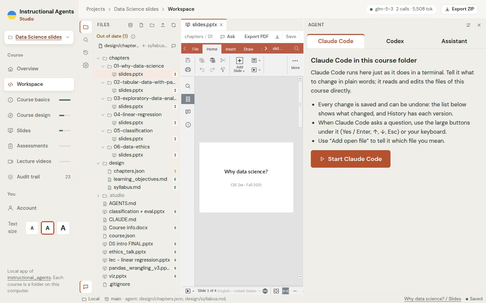

### Step 2: When it asks a question, click a large button to answer

The first time you use it in a folder, Claude Code asks whether you trust the folder. A large button for each choice appears below the terminal. Click **Yes, I trust this folder**.

Later questions, such as whether it may change a file, show the same kind of large buttons.

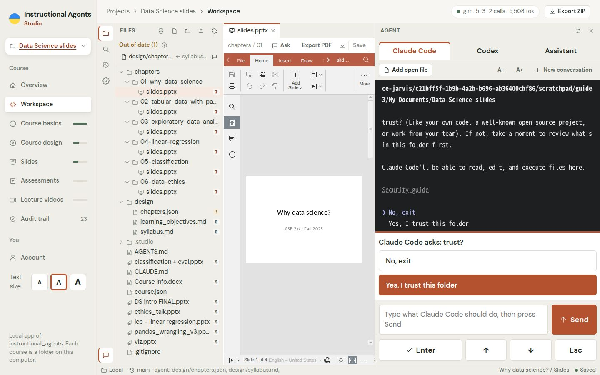
*Note: the choice highlighted by default is "No, exit". Click the button you want; do not just press Enter.*

### Step 3: Write your request in the large box at the bottom and click **Send**

First open the file you want changed (click it in the file list on the left), then click **Add open file**. The box now names that file (and the slides you selected). Then write what you want in plain words, for example:

```
On slide 2, add a bullet "Example: predicting house prices" under the existing bullets. Change nothing else.
```

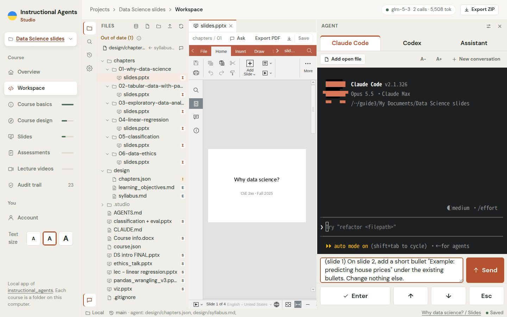

### Step 4: Wait until it is done, then look at "Changed in this conversation"

When the assistant says it is done, the bottom of the panel lists every file it changed. Click a file name to open it in the middle. Each change has already been saved as a version, and you can undo it at any time (see section 8).


It can also edit Word files and create new files, for example "In syllabus.docx, add a line with office hours after the Instructor line" or "Create a quiz file for week 1 with three multiple-choice questions".

**Codex** works the same way. Just click the **Codex** tab:

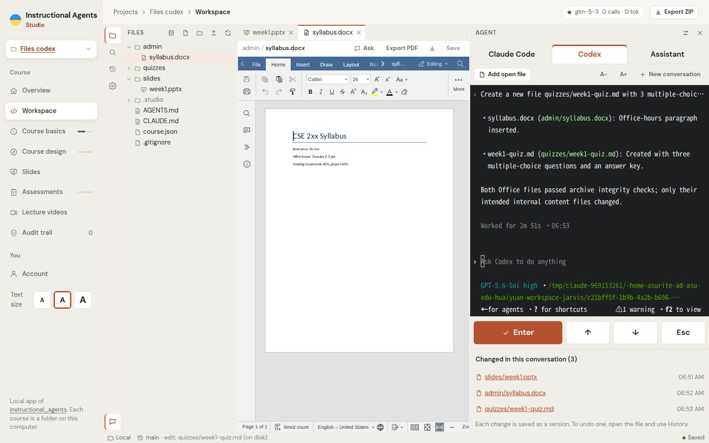
*After Codex changed the slides and a Word file and created a quiz file. All three changes are listed at the bottom of the panel.*

> **What the large buttons do**
> **Enter**: confirm the highlighted choice (the same as the Enter key). **↑** **↓**: move between choices. **Esc**: cancel a question, or ask the working assistant to stop.
> **A−** **A+**: change the text size in the terminal. **New conversation**: start a new conversation.

## 7. Edit slides and Word files yourself

In the **Workspace**, click a .pptx or .docx file on the left. The editor opens in the middle and works much like PowerPoint or Word. When you are done, click **Save** at the upper right (or press <kbd>Ctrl</kbd> + <kbd>S</kbd>; on a Mac, <kbd>⌘</kbd> + <kbd>S</kbd>).

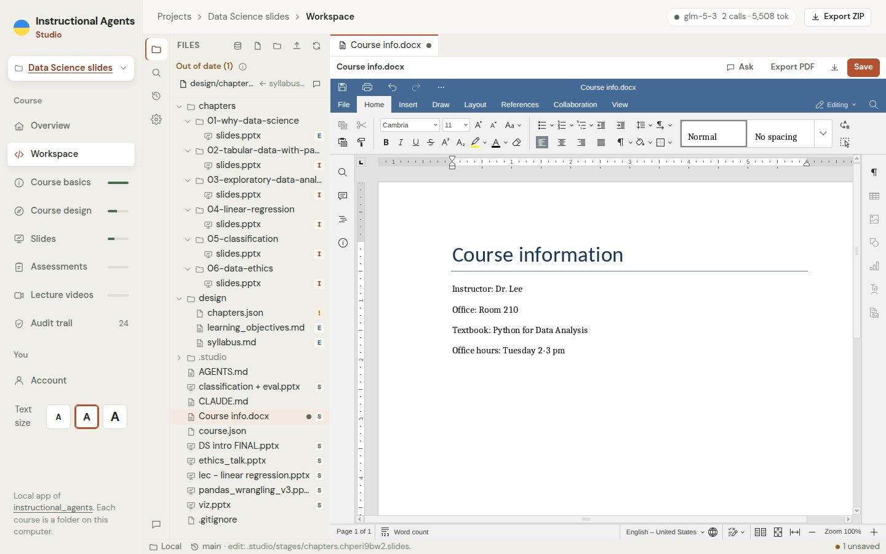
*When a file has unsaved changes, its tab shows a dot and the Save button turns orange.*

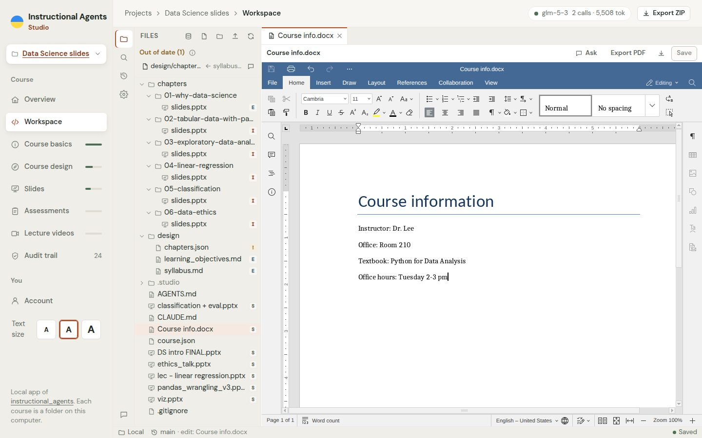
*After saving, the lower right shows "Saved".*

You can also open the files in the course folder with PowerPoint or Word on your computer. When you save there, the Studio records the change as a new version by itself.

## 8. See the history and undo changes

Open a file, then click the clock icon (History) in the column of icons on the left. It lists every version of the file: who changed it (agent means the assistant; edit means you or another program) and when. Click **Restore** to go back to a version. The restore is itself saved as a new version, so nothing is lost.

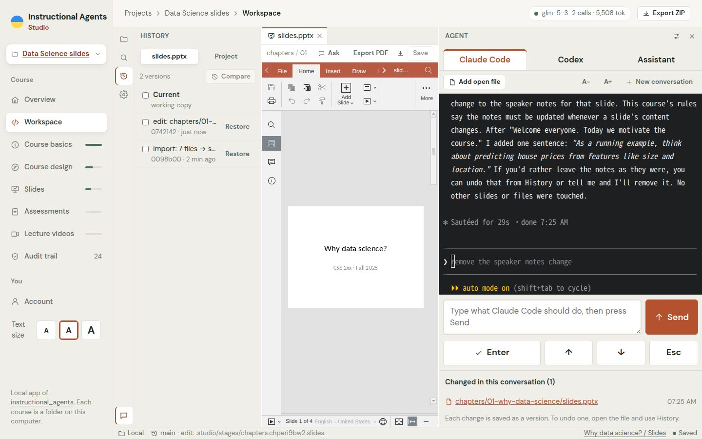

## 9. Make the text larger

**Text size** at the lower left has three A's, from small to large. Click the largest one and all the text on the page gets larger. The middle one (large) is the default. You can also change it under **Account** → **Generation defaults** → Appearance.

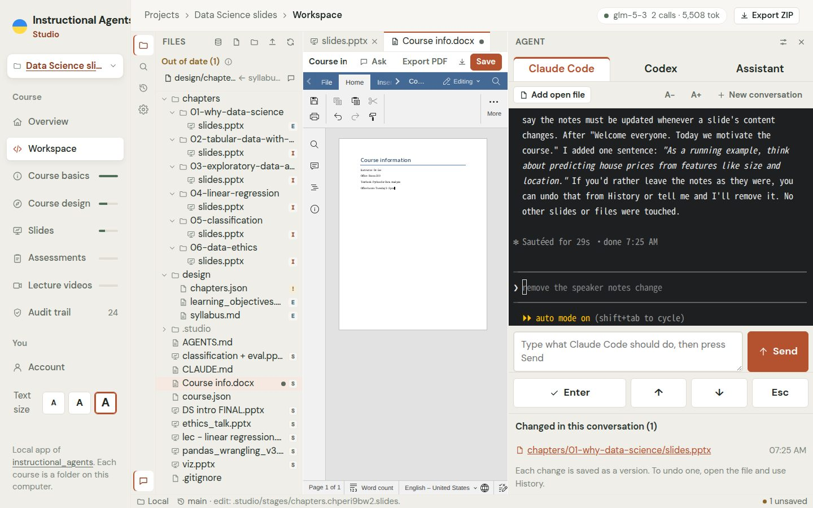

You can also use the browser's own zoom: <kbd>Ctrl</kbd> and <kbd>+</kbd> to zoom in, <kbd>Ctrl</kbd> and <kbd>-</kbd> to zoom out (<kbd>⌘</kbd> on a Mac).

## 10. If something goes wrong

| What you see | What to do |
|---|---|
| The page says "this tab needs its access link" | The page is from an earlier start. Go back to the terminal window and open the address after "Open", or type `npx instructional-agents` in the terminal again. |
| The page says "The app is not running" | The terminal window was closed. Open a terminal again and type `npx instructional-agents`. |
| Windows PowerShell says "running scripts is disabled" | Use Command Prompt (cmd) instead, or type `npx.cmd instructional-agents`. |
| The Claude Code tab says "not installed on this computer" | Install it and sign in once (section 1, step 2), then click **Check again**. |
| Claude Code stops right after starting and shows "has stopped" | Most likely "No" was chosen when it asked about trusting the folder. Click **Start Claude Code again** and this time click **Yes, I trust this folder**. |
| The assistant changed something wrongly | Click **Restore** in the history (section 8), or tell the assistant "undo the change you just made". |
| Opening slides says "editor is not installed" | Install the app again (`npx instructional-agents@latest`), then check the Editor line with `npx instructional-agents doctor`. |
| Generating says there is no API key | Enter the key as in section 3. |
